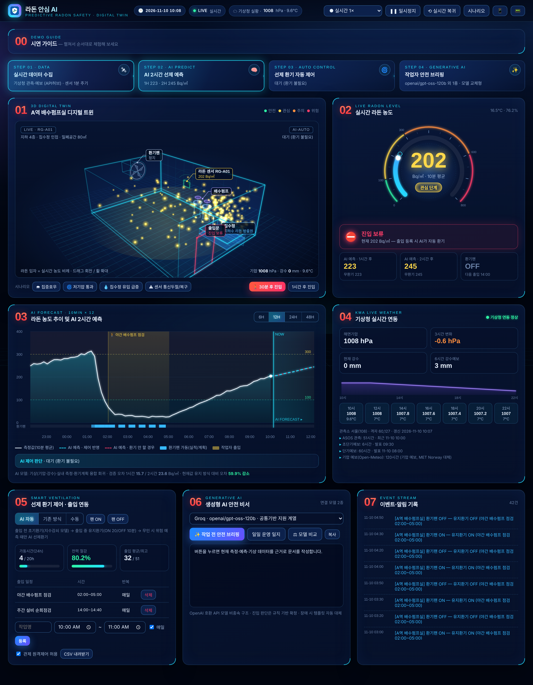
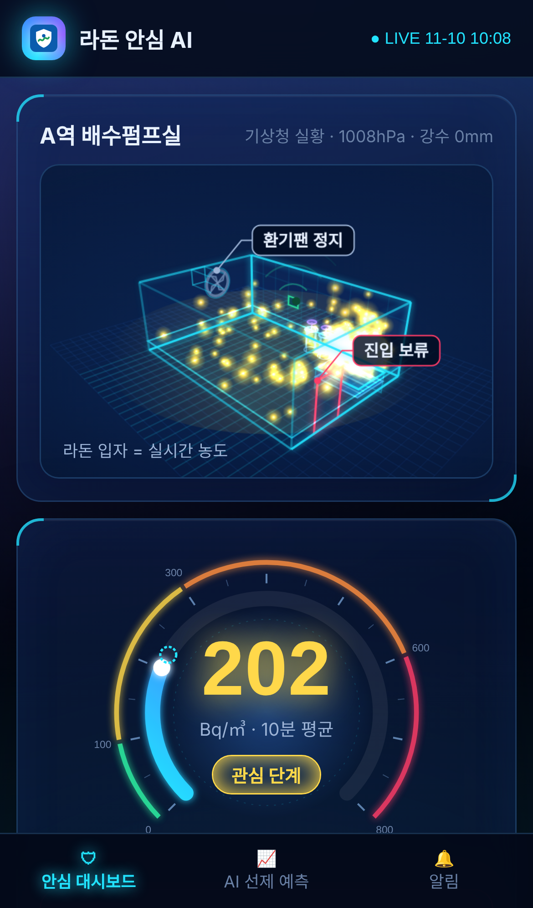
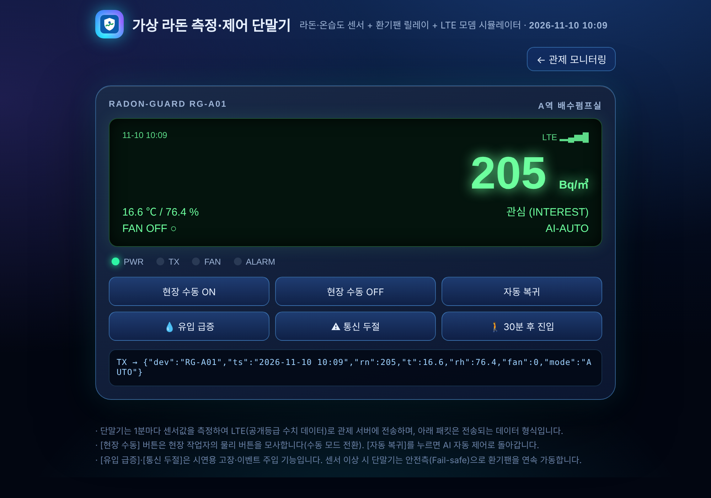

# 라돈 안심 AI — AI 기반 지하 밀폐공간 라돈 예측·선제환기 관리 시스템

> 2026 공공 AI 대전환 챌린지 세션1(자유주제) 출품작 · 서울교통공사 기술계획처

**온라인 시연:** https://radon-ai.onrender.com  ← 배포 후 실제 주소로 교체
(무료 서버라 15분 동안 접속이 없으면 잠듭니다. 첫 접속 시 30~60초 정도 기다리면 열립니다.)

지하철 배수펌프실 같은 지하 밀폐공간에는 1급 발암물질인 라돈이 쌓입니다. 이 시스템은 **기상청 실시간 관측·예보(기압·강수)와 실내 측정값을 AI로 분석해 10분~2시간 후 라돈 농도를 예측**합니다. 그리고 **작업자가 들어가기 전에 미리 환기팬을 가동**해 노출을 줄이고, 불필요한 상시 가동을 없애 전력을 절감합니다. **생성형 AI**는 측정·예측·기상 데이터를 근거로 작업 전 안전 브리핑과 운영 일지를 작성합니다.

하드웨어 없이 전 과정을 시연할 수 있도록 **A역 배수펌프실 3D 디지털 트윈, 가상 측정 단말기, 관제 모니터링, 모바일 앱(PWA)**을 하나의 웹 서비스로 구현했습니다.

| 관제 모니터링 | 모바일 앱 | 가상 측정 단말기 |
|---|---|---|
|  |  |  |

## 1. 접속 주소

| 화면 | 주소 | 용도 |
|---|---|---|
| 관제 모니터링 | `/` | A역 배수펌프실 3D 디지털 트윈, 실시간 농도 게이지, AI 예측, 기상청 연동, 출입·환기 제어, 생성형 AI |
| 모바일 앱 | `/mobile` | 작업자용 진입 가능 판단, 예측, 출입 등록, 알림 (홈 화면에 추가 가능) |
| 가상 단말기 | `/device` | 센서·환기팬 릴레이·LTE 전송 패킷 재현, 현장 버튼, 고장 주입 |
| 상태 점검 | `/api/diag` | 기상청·LLM 연동 상태 (인증키는 표시하지 않음) |

**접속자별로 독립된 세션**이 만들어집니다. 여러 심사위원이 동시에 접속해 출입 등록, 이벤트 발생, 배속 변경을 해도 서로 영향을 주지 않습니다. 상단의 [실시간 복귀]를 누르면 초기 상태로 돌아갑니다.

## 2. 주요 기능

| 구분 | 기능 |
|---|---|
| **실시간 기상 연동** | **기상청 공공데이터포털 API**에서 네 가지 자료를 10분마다 받습니다: ① 지상관측(ASOS) 시간자료(해면기압·기온·습도·강수, 전날까지 48시간), ② 초단기실황(현재 강수·기온·습도), ③ 초단기예보(6시간), ④ 단기예보(~3일). 기상청 API에는 당일 기압과 기압 예보가 없어서, 이 부분은 MET Norway 수치예보(장애 시 Open-Meteo)를 기상청 관측과 이어지도록 보간·보정해 씁니다. 키가 없거나 연결이 끊기면 자동으로 수치예보나 직전 자료로 대체합니다. 기상청 API허브 인증키(`KMA_AUTH_KEY`)도 지원합니다. |
| **AI 예측** | 기압 수준·3시간 변화·예보 변화, 강수(관측·예보·24시간 누적), 실내 라돈 추세, 습도, 환기 계획을 입력으로 받습니다. **10분 단위로 12개 시점(2시간)**을 예측하며, '환기하지 않을 경우'와 '제어 계획을 반영한 경우' 두 가지 예측선을 제공합니다. |
| **선제 환기 제어** | ① **초기환기**: 출입 전에 미리 가동합니다. 필요시간은 지수감쇠 모델 `t = ln(C예측/C목표)/(Q/V)`로 계산합니다. ② **유지환기**: 출입 중에는 ON 20분/OFF 10분을 반복하고, 목표 농도를 넘으면 즉시 가동합니다. ③ **AI 선제환기**: 무인 시간에는 1시간 안에 위험 단계(600)에 이를 것으로 예측될 때만 가동합니다. ④ **Fail-safe**: 센서에 이상이 생기면 연속 가동합니다. |
| **스마트 출입 연동** | 출입 일정(매일 반복 또는 1회)이나 긴급 출입을 등록하면 시각에 맞춰 자동으로 환기합니다. 환기가 끝나면 '진입 가능' 알림을 보내고, 시간이 부족하면 출입을 늦추라고 안내합니다. |
| **생성형 AI 안전 비서** | 작업 전 안전 브리핑과 일일 환기 운영 일지를 작성합니다. **모델을 고를 수 있고**(Groq: GPT-OSS 120B·20B, Qwen 등), **[모델 비교]로 두 모델 결과를 나란히** 볼 수 있습니다. |
| **3D 디지털 트윈** | 배수펌프실(집수정·배수펌프·환기팬·센서·출입문)을 3D로 재현. 라돈 입자 수·색이 실시간 농도와 단계를 따르고, 환기팬 가동 시 기류와 입자 배출, 출입 중 작업자 표시. 드래그 회전·휠 확대 |
| **관제·모바일** | 원형 게이지, 4단계 공정 흐름(데이터→예측→제어→브리핑), 농도 추이와 예측 차트, 환기팬 가동 이력, 기존 방식 대비 가동시간·전력 절감률, 이벤트·알림 기록, CSV 내려받기, 브라우저 알림과 진동을 제공합니다. |
| **비교 모드** | '기존 방식'(타이머로 하루 20시간 가동)으로 전환해 AI 자동 제어와 비교할 수 있습니다. |
| **시나리오 모드** | 합성 기상으로 최대 ×900까지 가속해 하루 운영을 몇 분 만에 볼 수 있습니다. |

## 3. 시연 순서 (핵심 흐름)

1. **실시간 모니터링**
   - 좌측 [기상 연동]에서 기상청 관측 시각, 해면기압, 3시간 변화, 6시간 강수예보를 확인합니다.
   - 차트에서 측정값(실선)과 AI 2시간 예측(점선)을 확인합니다.
2. **선제환기와 진입 알림**
   - [30분 후 진입]을 누르고 배속을 ×60으로 올립니다.
   - 초기환기가 시작되고, 100 Bq/㎥ 이하가 되면 관제·모바일에 '진입 가능' 알림이 뜹니다.
3. **기상 영향 대응**
   - [저기압 통과]·[집중호우]를 누르면 무환기 예측(빨간 점선)이 올라갑니다.
   - 위험 단계가 예측되면 AI 선제환기가 동작합니다.
4. **생성형 AI**
   - 모델을 골라 [작업 전 안전 브리핑]을 누릅니다.
   - [모델 비교]를 누르면 두 모델(예: GPT-OSS 120B와 Qwen) 결과를 나란히 볼 수 있습니다(2종 이상 모델 구동 입증).

## 4. 배포 (GitHub → Render 자동 배포)

이 저장소에는 `render.yaml`(Render Blueprint)이 들어 있어, GitHub에 올리면 바로 배포할 수 있습니다.

1. GitHub에 저장소를 만들고 이 폴더의 파일을 모두 올립니다.
2. [Render](https://render.com)에 GitHub 계정으로 로그인합니다.
3. **New → Blueprint**에서 저장소를 선택합니다.
4. 환경변수 두 개를 입력합니다.
   - `DATA_GO_KR_KEY`: 공공데이터포털 일반 인증키
   - `GROQ_API_KEY`: Groq API 키
5. 배포가 끝나면 `https://<서비스명>.onrender.com` 주소로 접속합니다.
6. 이후 GitHub에 커밋할 때마다 자동으로 다시 배포됩니다. GitHub Actions가 테스트도 자동으로 실행합니다.

**환경변수 목록**

| 변수 | 필수 | 설명 |
|---|---|---|
| `DATA_GO_KR_KEY` | 권장 | 공공데이터포털 일반 인증키. 없으면 Open-Meteo로 대체합니다. |
| `KMA_AUTH_KEY` | 선택 | 기상청 API허브 인증키(공공데이터포털 키 대신 사용 가능). |
| `GROQ_API_KEY` | 권장 | Groq LLM 키. 없으면 규칙 기반 템플릿으로 문서를 작성합니다. |
| `LLM_DEFAULT_MODEL` | 선택 | 기본 모델. 기본값은 `groq:openai/gpt-oss-120b`입니다. |
| `OPENAI_COMPAT_BASE_URL` / `_API_KEY` / `_MODELS` / `_NAME` | 선택 | 추가 공급자를 붙일 때 씁니다(Upstage Solar, Ollama, AI 공통기반 등). |
| `KMA_STN`, `KMA_NX`, `KMA_NY` | 선택 | 관측소와 예보 격자. 기본값은 서울 `108`, `60,127`입니다. |
| `ALLOW_REMOTE_CONTROL` | 선택 | `false`로 두면 관제에서 원격으로 ON/OFF할 수 없습니다(보안 정책). |
| `LLM_DAILY_LIMIT`, `LLM_SESSION_PER_HOUR` | 선택 | LLM 호출 한도. 기본값은 하루 800회, 세션당 시간당 30회입니다. |

**공공데이터포털 활용신청 목록** (data.go.kr, 자동승인)

- 기상청_지상(종관, ASOS) 시간자료 조회서비스 (`AsosHourlyInfoService`) — 전날 자료까지 제공
- 기상청_단기예보 조회서비스 (`VilageFcstInfoService_2.0`) — 초단기실황·초단기예보·단기예보

## 5. 로컬 실행

외부 패키지 설치가 필요 없습니다. Python 3.9 이상만 있으면 됩니다.

```bash
# (선택) 키 설정 — Windows는 set, macOS/Linux는 export
set DATA_GO_KR_KEY=...
set GROQ_API_KEY=...
python run.py            # http://localhost:8080
python run.py --offline  # 외부 연결 없이 합성 기상으로 실행
```

## 6. 구성

```
run.py                 실행기 (모델 → 실시간 기상 → 세션 관리 → 웹서버)
render.yaml            Render 자동 배포 설정 / Dockerfile: 기타 클라우드용
radon/
  kma.py               기상청 공공데이터포털·API허브(ASOS·실황·예보) + Open-Meteo 클라이언트
  weather.py           실시간 기상 합성(관측+예보+기압보정), 합성 기상, 세션별 시나리오 오버레이
  sim.py               밀폐공간 라돈 물리모델 + 가상 측정 단말기
  predictor.py         AI 예측 모델 (릿지 회귀, 순수 Python)
  controller.py        환기 제어 로직 (초기·유지·AI 선제환기, Fail-safe)
  engine.py            시뮬레이션 시계·데이터 기록·이벤트
  sessions.py          접속자별 독립 세션 (실시간 기준 엔진 복제)
  llm.py               생성형 AI 다중 공급자(OpenAI 호환) + 템플릿 대체
  server.py            HTTP API 서버 (표준 라이브러리)
web/                   관제(index), 모바일(mobile, PWA), 가상 단말기(device), 3D 디지털 트윈(twin3d.js)
data/                  투입 자료(읽기 전용): 모의데이터 CSV, 학습된 모델
tools/                 train.py (실측 CSV 재학습), make_mock_data.py
tests/                 단위·시나리오·기상 파서·LLM 테스트 (27개)
```

## 7. AI 모델과 데이터

- **모델:** 현장별·예측시점별(10~120분, 12개)로 학습한 다중회귀(릿지, 로그 농도)입니다. 입력 특징 14개는 `radon/predictor.py`에 정의되어 있습니다.
- **학습 데이터:** `data/mock_radon_30days.csv`는 30일치 10분 간격 **합성 모의데이터**입니다. 시연 현장은 A역 배수펌프실 1개소이고, 모델 일반화를 위해 체적·풍량이 다른 3개 유형으로 학습했습니다. 개인정보와 민감정보는 없습니다.
- **물리모델 보정:** 1-구획 질량수지 모델을 썼고, 배수펌프실 실측 수준에 맞췄습니다(개선 전 평균 432.4 Bq/㎥, 송풍기 개선 후 84.7 Bq/㎥).
- **검증 결과:** 마지막 20% 구간으로 검증했습니다. 2시간 예측 평균절대오차는 10.6~23.6 Bq/㎥이고, 현재값을 그대로 유지하는 방식보다 오차가 60~76% 작습니다.
- **실측 데이터로 재학습:** `python tools/train.py --csv 실측.csv`를 실행합니다. CSV 형식은 `radon/mockdata.py`에 적혀 있습니다.

## 8. 보안과 데이터 처리

- **인증키 관리:** 키는 서버 환경변수에만 둡니다. 화면, API 응답, 오류 메시지에는 나오지 않고, `authKey`는 자동으로 가려집니다.
- **전송 데이터:** 가상 단말기는 시설명·자산ID가 없는 단순 수치만 전송합니다. 국가 망 보안체계(N2SF)의 공개등급(Open) 데이터에 해당합니다.
- **원격 제어:** `ALLOW_REMOTE_CONTROL=false`로 관제의 원격 ON/OFF를 막을 수 있습니다. 「서울특별시 정보통신 보안업무 처리규칙」 제어시스템 보안 조항을 반영한 기능입니다.
- **남용 방지:** LLM 호출은 세션별·일별로 한도를 둡니다. 세션은 1시간 동안 접속이 없으면 자동으로 정리됩니다.

## 9. 테스트

```bash
python -m unittest discover -s tests -v
```

27개 항목을 검증합니다.

- 물리모델과 예측 정확도
- 환기 제어 시나리오: 출입시간 평균 100 Bq/㎥ 이하, 전력 70% 이상 절감
- 기상청 응답 파서(ASOS 텍스트, 예보 JSON, 강수 표기)
- 관측·예보 합성과 기압 편차 보정
- 장애 시 대체 동작
- 세션 독립성
- LLM 모델 교체와 템플릿 대체

## 10. 알려진 제약사항

- **가상 센서:** 라돈 측정값은 가상 단말기(물리모델)가 만든 값이고, 기상만 실제 자료입니다. 화면의 절감률과 정확도는 모의 환경 기준이며, 현장 실측 데이터로 다시 검증해야 합니다.
- **기압:** 기상청 ASOS는 전날 자료까지만 제공되고 예보 API에는 기압 항목이 없어, 당일·예보 기압은 MET Norway(장애 시 Open-Meteo) 수치예보를 기상청 관측과 이어지도록 보간해 씁니다.
- **무료 서버:** 접속이 없으면 잠듭니다. 메모리에만 저장하므로 재시작하면 기록이 초기화됩니다(최근 48시간은 기상청 관측으로 즉시 다시 만들어짐).
- **라이선스:** 외부 오픈소스 라이브러리를 쓰지 않았습니다(Python 표준 라이브러리와 순수 HTML/JS, 3D도 Canvas로 직접 구현). 웹폰트만 Google Fonts(Orbitron·Noto Sans KR, OFL)를 불러오며 연결이 안 되면 기본 글꼴로 표시됩니다. 재배포가 제한되는 구성요소가 없습니다.

## 11. 개발 경위와 참고

- 2026년 공사 AI 서비스 개발 과제 'AI 라돈 관리 시스템' 개발 계획을 바탕으로 했습니다. 관련 특허 출원: 「환기 제어 시스템 및 그 방법」, 10-2026-0109193, 서울교통공사.
- 배수펌프실 송풍기 개선(라돈 80.4% 감소)과 초기·유지 환기 알고리즘은 한국철도학회 발표 내용을 참고했습니다.
- 라돈 단계 기준은 한국산업안전보건공단 권고를 따랐습니다: 100 / 300 / 600 Bq/㎥.
- 기상 자료 출처: 기상청(공공데이터포털), MET Norway(CC BY 4.0), Open-Meteo(CC BY 4.0).
